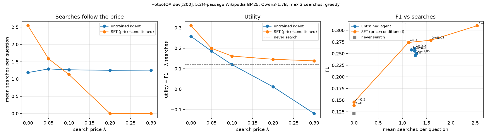

# Budget-Aware Search Agent

A small search agent that is told what each search costs and adjusts how much it searches. One model, one prompt field `Search cost: λ per search`: when searching is cheap it searches more to get the answer right, when it is expensive it answers from memory. Built on Qwen3-1.7B with LoRA on a single RTX 4080 (16 GB).

> Status: the price-conditioned SFT model is the current main result. Two GRPO pilots on top of it did not beat it (details below). The full development log, including every bug and wrong turn, is in [DEVLOG.md](DEVLOG.md) (Chinese). Related work and how this setup compares to it are in [RELATED_WORK.md](RELATED_WORK.md).

## Task

- Multi-hop questions from HotpotQA.
- The agent can call `<search>query</search>` up to 3 times. It gets BM25 top-3 passages from the full HotpotQA Wikipedia abstracts corpus (5.23 M passages) and ends with `<answer>…</answer>`.
- Reward: `F1(answer) − λ · (#searches)`, with λ ∈ {0, 0.05, 0.1, 0.2, 0.3} written into the prompt.

This sits next to OTC-PO, IKEA and AnySearch (see RELATED_WORK.md). AnySearch already trains one policy for any *hard* budget at 4–8B scale. This project uses a *soft* per-search price and is a small-scale replication and study rather than a new method.

## What the untrained model does

We forced the model to search exactly k times (its own queries) on 300 training questions:

| k searches | 0 | 1 | 2 | 3 |
|---|---|---|---|---|
| F1 | 0.185 | 0.293 | 0.344 | 0.348 |

So the best *fixed* number of searches depends on the price: 3 at λ=0, 2 at 0.05, 1 at 0.1, 0 at λ ≥ 0.2. Left to itself, the untrained agent ignores the price. It searches about 1.2 times at every λ and never answers without searching, which leaves 0.02–0.23 utility on the table. That gap is what training should close.

## SFT cold start (price-conditioned rejection sampling)

- **Data.** For 2000 other training questions, generate the four forced-k trajectories. For each price, imitate the one with the highest `F1 − λk`. Questions no k can answer take the price's default k. Trajectories with repeated queries are never targets.
- **Loss.** Wrong answers are masked out of the loss, so the model learns *when* to answer, not wrong facts.

Evaluated on 200 held-out dev questions (5.23 M-passage corpus, max 3 searches, greedy decoding):



| λ | untrained: searches / utility | SFT: F1 / searches / utility | gain [95% CI] |
|---|---|---|---|
| 0 | 1.19 / 0.258 | 0.310 / 2.54 / **0.310** | +0.052 [+0.011, +0.094] |
| 0.05 | 1.29 / 0.185 | 0.279 / 1.58 / **0.199** | +0.014 [−0.021, +0.051] |
| 0.1 | 1.26 / 0.120 | 0.274 / 1.12 / **0.161** | +0.042 [+0.009, +0.075] |
| 0.2 | 1.25 / 0.011 | 0.146 / 0.00 / **0.146** | +0.135 [+0.080, +0.189] |
| 0.3 | 1.25 / −0.119 | 0.138 / 0.00 / **0.138** | +0.258 [+0.199, +0.316] |

The intervals are paired bootstrap 95% CIs over the 200 questions (`scripts/compare.py`). The gain is significant at every price except λ=0.05.

For reference, never searching gets F1 0.121.

- **Criteria.** The pass/fail criteria for this step were written down before the run (DEVLOG §6.6), and all were met.
- **What changed.** One model now moves along the cost/accuracy curve when only the price in its prompt changes. The untrained model searches about 1.25 times whatever the price.
- **What SFT did not learn.** It learned mostly a price → search-count mapping, not per-question judgement. At λ ≥ 0.2 it never searches.
- **Caveat.** These are single-seed results on 200 questions.

## GRPO on top of SFT: three pre-registered pilots, none passed

The pass criterion was +0.02 mean utility over SFT across λ ∈ {0, 0.1, 0.3}, with no price worse by more than 0.01. Both pilots ran 40 steps with 16 questions × 8 rollouts per step and a KL penalty to the SFT model.

| pilot | setting | result |
|---|---|---|
| 1 | lr 1e-5, KL 0.001 (the literature's value) | Collapsed to *never search* at every price, including λ=0 where searching is free. Mean utility 0.136 / 0.165 at steps 20 / 40 vs 0.203 for SFT. |
| 2 | lr 2e-6, KL 0.05 | Stable for 20 steps. At step 20 it searched less at λ=0.1 (1.13 → 0.76) and gained a little utility, +0.005 on average, below the bar. By step 40 it drifted towards not searching again. |
| 3 | as 2, but training reward F1·(1 − λk): the cost only counts when the answer is right (OTC-PO-style) | Never collapsed. At step 40 it scored +0.007 on average, below the bar. The only significant change is at λ=0: +0.017 utility, 95% CI [+0.002, +0.035], at an unchanged search count. Better answers after searching, not better cost sensitivity. |

Why: with this 1.7B model, "searched and still wrong" is common. Under the additive reward it costs −λk, while "did not search and wrong" costs 0, so GRPO keeps pushing towards not searching. OTC-PO reports the same failure for additive efficiency rewards. Against SFT, pilot 2 at step 20 is within noise at every price: the largest gain is +0.011, with a 95% CI of [−0.016, +0.036]. Pilot 3 tested the fix: charging the cost only on correct answers removed the collapse, as OTC-PO and IKEA report, but 40 steps at this scale did not buy per-question cost sensitivity. Next steps would be the pilot 3 setup for more steps and larger batches, and a larger evaluation set with several seeds.

## Lessons recorded along the way

- Two early GRPO runs collapsed to "always search exactly once". The untrained policy almost never varied its search count, and a turn-limit bug punished multi-search episodes. Both runs were launched without a pre-registered pilot (DEVLOG problems 4–6).
- A literature comparison showed the first setup diverged from Search-R1/OTC/IKEA/AnySearch in several ways that mattered (RELATED_WORK.md §3). Since then every step is: offline diagnostic, then a pilot with pass/fail criteria written in advance, then the full run.

## Layout

```
basa/data.py         HotpotQA questions (+ small distractor-paragraph corpus)
basa/wiki.py         full HotpotQA Wikipedia abstracts corpus + BM25 index (5.23 M passages)
basa/retriever.py    BM25 search tool, batched multi-threaded retrieval with a cache
basa/rollout.py      multi-turn rollouts; loss mask excludes prompt and search results
basa/sft.py          price-conditioned SFT cold start
basa/train_grpo.py   GRPO with KL to a reference model, LoRA
basa/evaluate.py     baselines (no_search / rag1 / react) and trained adapters
scripts/diagnose.py  forced-k diagnostic: fixed vs per-type vs oracle vs free agent
scripts/make_sft_data.py  forced-k trajectories for SFT
```

## Reproduce

```bash
python -m venv .venv
.venv/Scripts/python -m pip install torch --index-url https://download.pytorch.org/whl/cu128
.venv/Scripts/python -m pip install -r requirements.txt
# full Wikipedia abstracts (1.55 GB) from the HotpotQA authors, then build the BM25 index
curl -L -o cache/wiki/enwiki-abstracts.tar.bz2 https://nlp.stanford.edu/projects/hotpotqa/enwiki-20171001-pages-meta-current-withlinks-abstracts.tar.bz2
.venv/Scripts/python -m basa.wiki
.venv/Scripts/python scripts/diagnose.py --corpus wiki --n 300 --out results/diag_wiki
.venv/Scripts/python scripts/make_sft_data.py --start 300 --n 2000 --corpus wiki
.venv/Scripts/python -m basa.sft --data cache/sft/traj_wiki.pt --out runs/sft_wiki
.venv/Scripts/python -m basa.evaluate --methods trained --adapter runs/sft_wiki --corpus wiki --n 200 --max_calls 3 --lams 0,0.1,0.3
```
